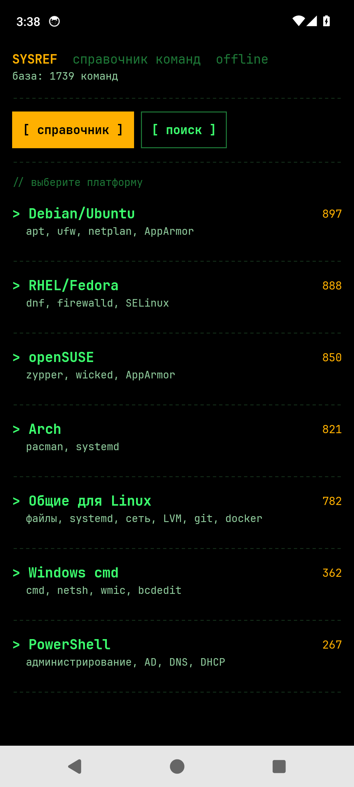
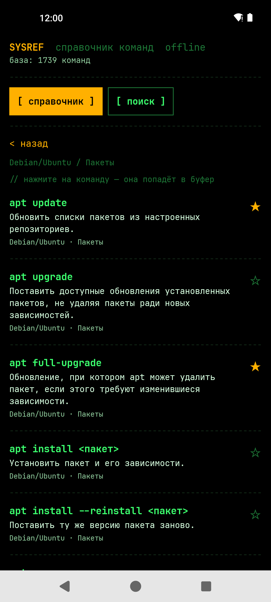
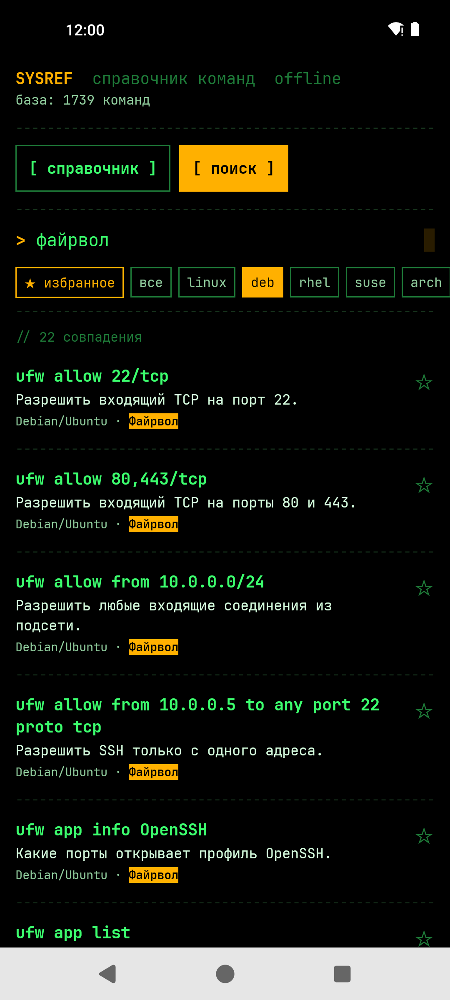
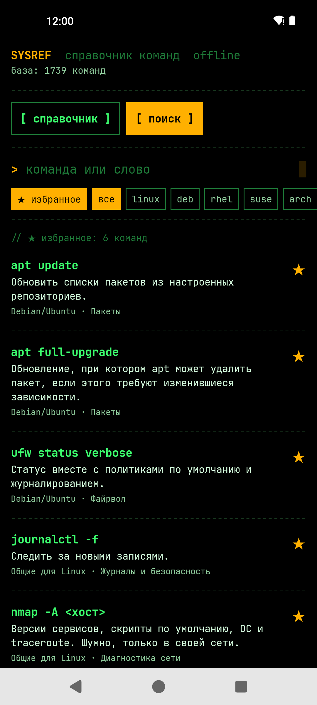
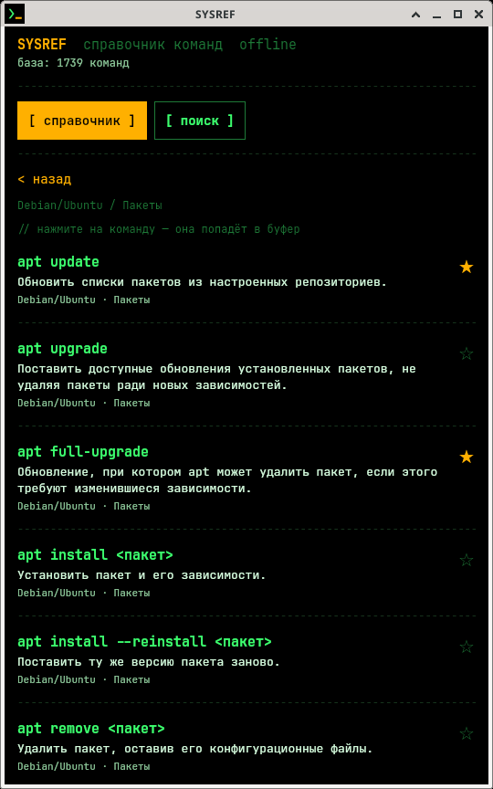
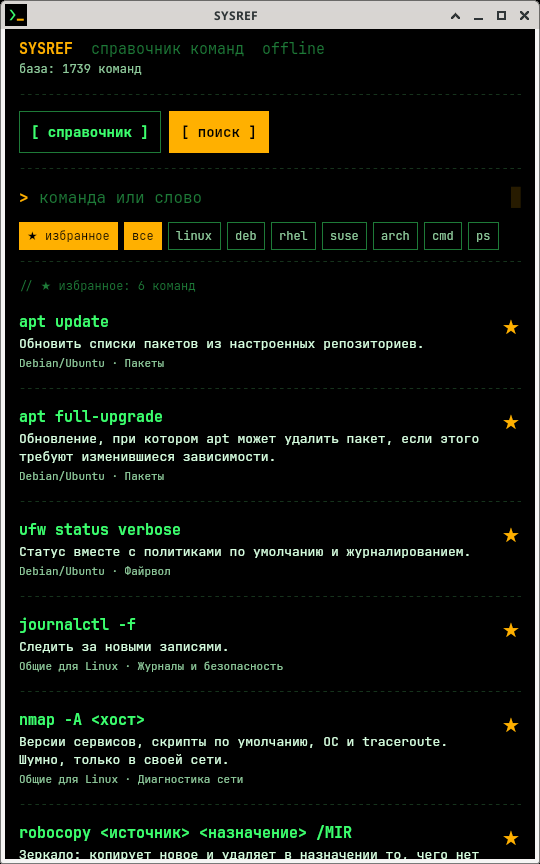

# SYSREF

Офлайн-справочник команд системного администратора. Интерфейс на русском и выглядит как терминал: чёрный фон, моноширинный шрифт, зелёный и янтарный текст, строка запроса в виде `> _`.

Сеть приложению не нужна. Все 1739 команд лежат внутри APK. Нажатие на строку копирует команду в буфер обмена.

Идентификатор приложения: `com.sysref.commands`.

С версии 1.2.0 есть и десктопная версия для Windows и Linux с тем же интерфейсом, базой и избранным, см. [Десктоп (Windows/Linux)](#десктоп-windowslinux).

## Скриншоты

Список платформ. Сверху пункт «★ Избранное» со счётчиком сохранённых команд:



Раздел «Пакеты» для Debian/Ubuntu. Звёздочка справа добавляет команду в избранное (★ — уже в избранном, ☆ — нет):



Поиск по фрагменту `nmap`. Совпадение подсвечено, точные и префиксные команды идут первыми:


Поиск по русскому слову `файрвол` с фильтром Debian/Ubuntu:



Включён чип «★ избранное»: без запроса показываются все избранные команды. Чип работает вместе с запросом и фильтром платформы:



Десктопная версия (Linux): справочник со звёздочками и поиск с включённым чипом «★ избранное»:




## Десктоп (Windows/Linux)

Десктопная версия собрана из того же кода, что и Android-приложение (Compose Multiplatform). Внутри та же база команд, тот же поиск, фильтры и избранное. Установщики лежат в [Releases](https://github.com/dalem-732/SYSREF/releases/latest). Внутри у каждого своя Java, поэтому отдельно ставить её не нужно. Размер 50–65 МБ.

**Windows 10/11:** скачайте `SYSREF-<версия>.msi` и запустите. Ставится для текущего пользователя, права администратора не нужны. Ярлык появится в меню «Пуск» и на рабочем столе. Установщик не подписан платным сертификатом, поэтому Windows SmartScreen может показать «Система Windows защитила ваш компьютер». Нажмите **Подробнее → Выполнить в любом случае**. Новая версия ставится поверх старой.

**Debian/Ubuntu:**

```bash
sudo apt install ./sysref_*.deb
```

Пакет собран на Ubuntu 24.04 и ссылается на её библиотеки (`libasound2t64` и т. п.), поэтому нужна Ubuntu 24.04+, Debian 13+ или их производные. На более старых системах берите архив `.tar.gz` (ниже).

**Fedora/RHEL/openSUSE:**

```bash
sudo dnf install ./sysref-*.rpm      # Fedora, RHEL, Rocky
sudo zypper install ./sysref-*.rpm   # openSUSE
```

**Любой Linux x86_64 без установки:** распакуйте `sysref-v<версия>-linux-x64.tar.gz` и запустите `SYSREF/bin/SYSREF`.

После установки из пакета программа лежит в `/opt/sysref/` и есть в меню приложений, запуск из терминала: `/opt/sysref/bin/SYSREF`. Удаление: `sudo apt remove sysref` или `sudo dnf remove sysref`, на Windows через «Приложения».

Управление: мышь и клавиатура. **Ctrl+F** открывает поиск и ставит курсор в строку запроса. **Esc** очищает запрос, а если он пуст, возвращает на шаг назад. Щелчок по команде копирует её в буфер обмена, ☆ добавляет команду в избранное.

Избранное хранится в файле пользователя: на Windows `%APPDATA%\SYSREF\favorites.json`, на Linux `~/.config/sysref/favorites.json` (или `$XDG_CONFIG_HOME/sysref/`). С телефоном оно не синхронизируется.

## Возможности

- Справочник: платформа, затем раздел, затем список команд с описанием.
- Платформы: Debian/Ubuntu, RHEL/Fedora (Rocky и CentOS в том же наборе), openSUSE, Arch, команды общие для Linux, Windows cmd, PowerShell.
- У дистрибутива в списке также видны общие команды Linux: `grep` на Debian не дублируется отдельной записью.
- Разделы: пакеты, службы, файрвол, сеть, диагностика сети, пользователи, диски, LVM, файлы и каталоги, права, архивы, текст, процессы, systemd, планировщик, журналы и безопасность, оболочка, удалённый доступ, Git, Docker, система, загрузка и восстановление, задачи, реестр, AD/DNS/DHCP.
- Поиск по мере ввода. Ищет по тексту команды, описанию, названию раздела и платформы. Регистр не важен, `ё` совпадает с `е`, фрагмент ищется и внутри слова.
- Сначала идут точное совпадение команды, затем команда с таким началом, затем совпадение в отдельном слове команды, затем вхождение в команду, и только потом описание, раздел и платформа.
- Чипы фильтра: все, linux, deb, rhel, suse, arch, cmd, ps. Чип дистрибутива оставляет и его собственные команды, и общие для Linux.
- Нажатие копирует команду. Снизу появляется строка «скопировано». На Android 13 и новее система дополнительно показывает свою плашку буфера.
- Избранное: звёздочка ☆ справа от команды добавляет её в избранное, повторное нажатие убирает. Чип «★ избранное» в поиске оставляет только избранные команды и работает вместе с запросом и чипом платформы; без запроса он показывает всё избранное. На главном экране есть пункт «★ Избранное». Список хранится только на устройстве (SharedPreferences), ключ записи — `платформа/раздел/команда`, поэтому избранное не сбивается при изменении порядка команд в базе.

## Сколько команд

Всего **1739**.

| Платформа | Код в JSON | Записей |
| --- | --- | --- |
| Debian/Ubuntu | `debian` | 115 |
| RHEL/Fedora | `rhel` | 106 |
| openSUSE | `suse` | 68 |
| Arch | `arch` | 39 |
| Общие для Linux | `linux` | 782 |
| Windows cmd | `cmd` | 362 |
| PowerShell | `ps` | 267 |

В карточке Debian/Ubuntu приложение показывает больше, чем 115: к дистрибутиву добавляются 782 общие команды. То же для RHEL, openSUSE и Arch.

## Стек

- Kotlin 2.0, Jetpack Compose / Compose Multiplatform 1.7, Material 3
- Модули: `shared` (Kotlin Multiplatform: Android + JVM desktop), `app` (Android), `desktop` (Windows/Linux)
- kotlinx.serialization для чтения базы, Compose Multiplatform Resources для базы и шрифта
- Android Gradle Plugin 8.7.3, Gradle 8.11.1
- `minSdk` 24, `targetSdk` 35, `compileSdk` 35
- Байткод Java/Kotlin: 17
- JDK для сборки: 17 или 21
- Шрифт JetBrains Mono (лицензия OFL, текст в `third_party/jetbrains-mono/`)

## Структура

```text
shared/                             общий код Android и десктопа (Kotlin Multiplatform)
    src/commonMain/composeResources/files/commands.json   база команд
    src/commonMain/composeResources/font/                 JetBrains Mono
    src/commonMain/kotlin/com/sysref/commands/
        Model.kt                    платформы, разделы, ранжирование поиска
        Favorites.kt                избранное: фильтр и интерфейс хранилища
        CommandRepository.kt        чтение commands.json
        ui/SysRefApp.kt             справочник, поиск, копирование, избранное
        ui/Theme.kt                 цвета терминала и шрифт
        ui/Platform.kt              системная «назад» и горячие клавиши
    src/androidMain/                избранное в SharedPreferences, BackHandler
    src/desktopMain/                избранное в JSON-файле пользователя
    src/commonTest/, src/desktopTest/   unit-тесты
app/                                Android-приложение (MainActivity, манифест, значок, подпись)
desktop/                            окно, Ctrl+F/Esc, упаковка MSI/DEB/RPM, значки
tools/entries_linux.py              исходные записи Linux
tools/entries_windows.py            исходные записи Windows
tools/build_commands.py             сборка JSON и проверка дублей
docs/screenshots/                   снимки экрана для README
fastlane/metadata/android/          тексты, значок и снимки для F-Droid
docs/fdroid-metadata.yml            черновик метаданных fdroiddata, в сборку не входит
docs/fdroid-inclusion.md            как повторить подготовку к F-Droid
```

Приложение не обращается к Python. Скрипт нужен только чтобы править базу и заново собрать JSON.

Формат `commands.json`:

```json
{
  "version": 1,
  "commands": [
    {
      "command": "apt update",
      "description": "Обновить списки пакетов из настроенных репозиториев.",
      "platform": "debian",
      "category": "packages"
    }
  ]
}
```

`platform`: `debian`, `rhel`, `suse`, `arch`, `linux`, `cmd`, `ps`.

`category`: `packages`, `services`, `firewall`, `network`, `nettools`, `users`, `disks`, `lvm`, `files`, `perms`, `archive`, `text`, `process`, `systemd`, `cron`, `logs`, `shell`, `remote`, `git`, `docker`, `system`, `boot`, `tasks`, `registry`, `ad`.

Русские названия платформ и разделов заданы в `Model.kt`, не в JSON. Плейсхолдеры вроде `<пакет>` остаются частью строки команды.

## Как править команды

1. Добавьте или измените пару "команда, описание" в `tools/entries_linux.py` или `tools/entries_windows.py`.
2. Платформа и раздел должны быть из списков выше. Скрипт иначе остановится.
3. Соберите JSON:

```bash
python3 tools/build_commands.py
```

Скрипт пишет `shared/src/commonMain/composeResources/files/commands.json`, не пускает пустые поля и одинаковые тройки платформа + раздел + команда. Общая команда Linux с тем же текстом, что и у дистрибутива, в выдаче дистрибутива остаётся один раз.

Править JSON руками тоже можно. После ручной правки генератор при следующем запуске перезапишет файл из Python-исходников.

Флаги в описаниях должны быть настоящими. Если утилита не входит в минимальную установку, это лучше прямо сказать в описании.

## Сборка

Нужны JDK 17 или 21 и Android SDK: платформа Android 35 и Build-Tools 35.0.0. Переменная `ANDROID_HOME` указывает на SDK. Android Studio сама создаёт `local.properties` с `sdk.dir`. Этот файл в git не входит.

### Android Studio

Откройте каталог проекта. Дождитесь синхронизации Gradle. Конфигурация запуска - `app`. Сборка debug: **Build -> Build Bundle(s) / APK(s) -> Build APK(s)**. Готовый файл:

```text
app/build/outputs/apk/debug/app-debug.apk
```

Нужна Android Studio, которая понимает Android Gradle Plugin 8.7.

### Командная строка

```bash
export ANDROID_HOME="$HOME/Android/Sdk"   # или путь к вашему SDK
./gradlew :app:assembleDebug
./gradlew :app:assembleRelease
./gradlew :shared:desktopTest :shared:testDebugUnitTest   # unit-тесты общего кода
```

Десктоп (нужен JDK 17+ с `jpackage`, например Temurin):

```bash
./gradlew :desktop:run                 # запустить окно
./gradlew :desktop:packageDeb          # Linux .deb (нужен fakeroot)
./gradlew :desktop:packageRpm          # Linux .rpm (нужен rpmbuild, пакет rpm)
./gradlew :desktop:packageMsi          # Windows .msi, только на Windows (WiX скачивается сам)
./gradlew :desktop:createDistributable # папка с программой без установщика
```

Готовые пакеты лежат в `desktop/build/compose/binaries/main/`. Установщик собирается только под ту ОС, на которой запущена сборка. В релизах их собирает GitHub Actions: Linux на `ubuntu-latest`, MSI на `windows-latest`.

На Windows те же задачи запускает `gradlew.bat`.

`assembleDebug` подписывает APK отладочным ключом. Его можно ставить на телефон.

`assembleRelease` собирает **неподписанный** APK, если не задана переменная `KEYSTORE_FILE`. Минификация выключена. Так собирает F-Droid: своих ключей у него нет, подпись ставит сам. Файл:

```text
app/build/outputs/apk/release/app-release-unsigned.apk
```

Его нельзя поставить, пока он не подписан. Своя подпись включается только вместе с переменными окружения. Те же имена использует `.github/workflows/release.yml`:

- `KEYSTORE_FILE` — путь к хранилищу `.jks` или `.keystore`
- `KEYSTORE_PASSWORD`
- `KEY_ALIAS`
- `KEY_PASSWORD`

```bash
export KEYSTORE_FILE=/абсолютный/путь/release.jks
export KEYSTORE_PASSWORD=...
export KEY_ALIAS=...
export KEY_PASSWORD=...
./gradlew assembleRelease
```

Без `KEYSTORE_FILE` блок `signingConfig` не создаётся. Пароли и файл хранилища в репозиторий не кладите: `*.jks`, `*.keystore` и `keystore.properties` уже в `.gitignore`.

Обёртка Gradle уже в репозитории: `gradlew`, `gradlew.bat`, `gradle/wrapper/`. Отдельно ставить Gradle не нужно.

## Установка APK

Файл для установки вручную - `app-debug.apk` (или подписанный release).

На телефоне разрешите установку из этого источника:

1. Откройте APK в "Файлах" или передайте его через `adb install -r app-debug.apk`.
2. Если система спросит разрешение, зайдите в настройки приложения, из которого ставите файл (файловый менеджер или браузер), и включите "Установку неизвестных приложений".
3. Подтвердите установку. Иконка на рабочем столе - **SYSREF**.

Обновление поверх старой сборки с той же подписью сохраняет обычную установку. Смена ключа подписи потребует сначала удалить приложение.

## Ограничения

- Описания короткие. Это карточка команды, а не страница руководства.
- Часть программ не стоит в минимальной системе: nmap, tcpdump, smartctl, fail2ban, Docker, Flatpak. В тексте это отмечено там, где без пакета команду не вызвать.
- Командлеты Active Directory, DNS и DHCP есть на контроллере домена или на машине с RSAT, не на домашней Windows.
- `wmic` устарел и в новых сборках Windows 11 удалён. Рядом есть те же сведения через CIM и PowerShell.
- Синтаксис `nc` зависит от сборки netcat. Для проверки порта в базе указан `ncat` из пакета nmap.
- Поиск - это подстрока, а не исправление опечаток.
- Release без переменной `KEYSTORE_FILE` не подписан и на телефон не ставится.
- Десктопные установщики не подписаны: на Windows возможно предупреждение SmartScreen. `.deb` рассчитан на Ubuntu 24.04+/Debian 13+, для старых систем есть `.tar.gz`. Сборок для macOS и ARM нет.
- Интерфейс только тёмный и только на русском. Локализации интерфейса нет, описания команд тоже на русском.

## F-Droid

F-Droid собирает только Android-модуль `app` (`subdir: app`). Модули `shared` и `desktop` ему не мешают, все зависимости берутся из Google Maven и Maven Central. Сборка `assembleRelease` без `KEYSTORE_FILE` остаётся неподписанной: F-Droid собирает её сам и подписывает своим ключом. Тексты, значок и снимки карточки лежат в `fastlane/metadata/android/` (`ru` и `en-US`).

Черновик метаданных для репозитория [fdroiddata](https://gitlab.com/fdroid/fdroiddata) — `docs/fdroid-metadata.yml`. В сборку приложения он не входит. В fdroiddata его кладут как `metadata/com.sysref.commands.yml` после тега `v1.0.0` на коммите, где `versionName` равен `1.0.0`, а `versionCode` равен `1`. Как повторить подготовку: [docs/fdroid-inclusion.md](docs/fdroid-inclusion.md).

## Лицензия

Код и тексты команд - [MIT](LICENSE).

Шрифт JetBrains Mono распространяется по лицензии SIL Open Font License 1.1 (OFL). Текст лицензии и авторы: `third_party/jetbrains-mono/`.
