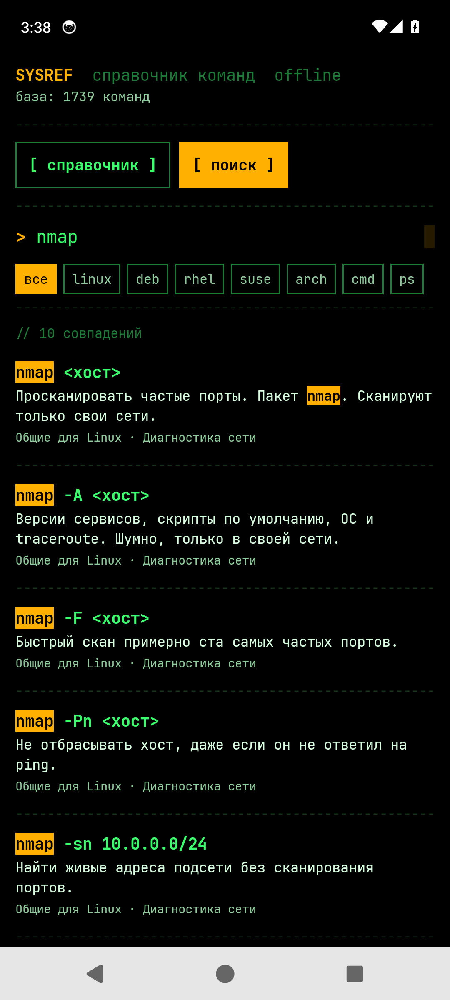

# SYSREF

Офлайн-справочник команд системного администратора. Интерфейс на русском и выглядит как терминал: чёрный фон, моноширинный шрифт, зелёный и янтарный текст, строка запроса в виде `> _`.

Сеть приложению не нужна. Все 1739 команд лежат внутри APK. Нажатие на строку копирует команду в буфер обмена.

Идентификатор приложения: `com.sysref.commands`.

## Скриншоты

Список платформ:


Раздел «Пакеты» для Debian/Ubuntu:


Поиск по фрагменту `nmap`. Совпадение подсвечено, точные и префиксные команды идут первыми:



Поиск по русскому слову `файрвол` с фильтром Debian/Ubuntu:


## Возможности

- Справочник: платформа, затем раздел, затем список команд с описанием.
- Платформы: Debian/Ubuntu, RHEL/Fedora (Rocky и CentOS в том же наборе), openSUSE, Arch, команды общие для Linux, Windows cmd, PowerShell.
- У дистрибутива в списке также видны общие команды Linux: `grep` на Debian не дублируется отдельной записью.
- Разделы: пакеты, службы, файрвол, сеть, диагностика сети, пользователи, диски, LVM, файлы и каталоги, права, архивы, текст, процессы, systemd, планировщик, журналы и безопасность, оболочка, удалённый доступ, Git, Docker, система, загрузка и восстановление, задачи, реестр, AD/DNS/DHCP.
- Поиск по мере ввода. Ищет по тексту команды, описанию, названию раздела и платформы. Регистр не важен, `ё` совпадает с `е`, фрагмент ищется и внутри слова.
- Сначала идут точное совпадение команды, затем команда с таким началом, затем совпадение в отдельном слове команды, затем вхождение в команду, и только потом описание, раздел и платформа.
- Чипы фильтра: все, linux, deb, rhel, suse, arch, cmd, ps. Чип дистрибутива оставляет и его собственные команды, и общие для Linux.
- Нажатие копирует команду. Снизу появляется строка «скопировано». На Android 13 и новее система дополнительно показывает свою плашку буфера.

## Сколько команд

Всего **1739**.

| Платформа | Код в JSON | Записей |
| --- | --- | --- |
| Debian/Ubuntu | `debian` | 115 |
| RHEL/Fedora | `rhel` | 106 |
| openSUSE | `suse` | 68 |
| Arch | `arch` | 39 |
| Общие для Linux | `linux` | 782 |
| Windows cmd | `cmd` | 362 |
| PowerShell | `ps` | 267 |

В карточке Debian/Ubuntu приложение показывает больше, чем 115: к дистрибутиву добавляются 782 общие команды. То же для RHEL, openSUSE и Arch.

## Стек

- Kotlin 2.0, Jetpack Compose, Material 3
- Android Gradle Plugin 8.7.3, Gradle 8.11.1
- `minSdk` 24, `targetSdk` 35, `compileSdk` 35
- Байткод Java/Kotlin: 17
- JDK для сборки: 17 или 21
- Шрифт JetBrains Mono (лицензия OFL, текст в `third_party/jetbrains-mono/`)

## Структура

```text
app/src/main/assets/commands.json   база, которую читает приложение
app/src/main/java/com/sysref/commands/
    MainActivity.kt                 загрузка базы и параметры запуска
    Model.kt                        платформы, разделы, ранжирование поиска
    Repository.kt                   разбор JSON из assets
    ui/SysRefApp.kt                 справочник, поиск, копирование
    ui/Theme.kt                     цвета терминала и шрифт
tools/entries_linux.py              исходные записи Linux
tools/entries_windows.py            исходные записи Windows
tools/build_commands.py             сборка JSON и проверка дублей
docs/screenshots/                   снимки экрана для README
```

Приложение не обращается к Python. Скрипт нужен только чтобы править базу и заново собрать JSON.

Формат `commands.json`:

```json
{
  "version": 1,
  "commands": [
    {
      "command": "apt update",
      "description": "Обновить списки пакетов из настроенных репозиториев.",
      "platform": "debian",
      "category": "packages"
    }
  ]
}
```

`platform`: `debian`, `rhel`, `suse`, `arch`, `linux`, `cmd`, `ps`.

`category`: `packages`, `services`, `firewall`, `network`, `nettools`, `users`, `disks`, `lvm`, `files`, `perms`, `archive`, `text`, `process`, `systemd`, `cron`, `logs`, `shell`, `remote`, `git`, `docker`, `system`, `boot`, `tasks`, `registry`, `ad`.

Русские названия платформ и разделов заданы в `Model.kt`, не в JSON. Плейсхолдеры вроде `<пакет>` остаются частью строки команды.

## Как править команды

1. Добавьте или измените пару "команда, описание" в `tools/entries_linux.py` или `tools/entries_windows.py`.
2. Платформа и раздел должны быть из списков выше. Скрипт иначе остановится.
3. Соберите JSON:

```bash
python3 tools/build_commands.py
```

Скрипт пишет `app/src/main/assets/commands.json`, не пускает пустые поля и одинаковые тройки платформа + раздел + команда. Общая команда Linux с тем же текстом, что и у дистрибутива, в выдаче дистрибутива остаётся один раз.

Править JSON руками тоже можно. После ручной правки генератор при следующем запуске перезапишет файл из Python-исходников.

Флаги в описаниях должны быть настоящими. Если утилита не входит в минимальную установку, это лучше прямо сказать в описании.

## Сборка

Нужны JDK 17 или 21 и Android SDK: платформа Android 35 и Build-Tools 35.0.0. Переменная `ANDROID_HOME` указывает на SDK. Android Studio сама создаёт `local.properties` с `sdk.dir`. Этот файл в git не входит.

### Android Studio

Откройте каталог проекта. Дождитесь синхронизации Gradle. Конфигурация запуска - `app`. Сборка debug: **Build -> Build Bundle(s) / APK(s) -> Build APK(s)**. Готовый файл:

```text
app/build/outputs/apk/debug/app-debug.apk
```

Нужна Android Studio, которая понимает Android Gradle Plugin 8.7.

### Командная строка

```bash
export ANDROID_HOME="$HOME/Android/Sdk"   # или путь к вашему SDK
./gradlew assembleDebug
./gradlew assembleRelease
./gradlew testDebugUnitTest
```

На Windows те же задачи запускает `gradlew.bat`.

`assembleDebug` подписывает APK отладочным ключом. Его можно ставить на телефон.

`assembleRelease` сейчас собирает **неподписанный** APK: минификация выключена, хранилище подписи не задано. Файл:

```text
app/build/outputs/apk/release/app-release-unsigned.apk
```

Его нельзя поставить, пока он не подписан. Для своей подписи создайте хранилище и файл `keystore.properties` в корне проекта (оба пути в `.gitignore`):

```properties
storeFile=/абсолютный/путь/release.jks
storePassword=...
keyAlias=...
keyPassword=...
```

Дальше в `app/build.gradle.kts` у типа `release` укажите `signingConfig` на это хранилище и снова выполните `./gradlew assembleRelease`. Пароли в репозиторий не кладите.

Обёртка Gradle уже в репозитории: `gradlew`, `gradlew.bat`, `gradle/wrapper/`. Отдельно ставить Gradle не нужно.

## Установка APK

Файл для установки вручную - `app-debug.apk` (или подписанный release).

На телефоне разрешите установку из этого источника:

1. Откройте APK в "Файлах" или передайте его через `adb install -r app-debug.apk`.
2. Если система спросит разрешение, зайдите в настройки приложения, из которого ставите файл (файловый менеджер или браузер), и включите "Установку неизвестных приложений".
3. Подтвердите установку. Иконка на рабочем столе - **SYSREF**.

Обновление поверх старой сборки с той же подписью сохраняет обычную установку. Смена ключа подписи потребует сначала удалить приложение.

## Ограничения

- Описания короткие. Это карточка команды, а не страница руководства.
- Часть программ не стоит в минимальной системе: nmap, tcpdump, smartctl, fail2ban, Docker, Flatpak. В тексте это отмечено там, где без пакета команду не вызвать.
- Командлеты Active Directory, DNS и DHCP есть на контроллере домена или на машине с RSAT, не на домашней Windows.
- `wmic` устарел и в новых сборках Windows 11 удалён. Рядом есть те же сведения через CIM и PowerShell.
- Синтаксис `nc` зависит от сборки netcat. Для проверки порта в базе указан `ncat` из пакета nmap.
- Поиск - это подстрока, а не исправление опечаток.
- Release без своего хранилища не подписан и на телефон не ставится.
- Интерфейс только тёмный и только на русском. Локализации интерфейса нет, описания команд тоже на русском.

## Лицензия

Код и тексты команд - [MIT](LICENSE).

Шрифт JetBrains Mono распространяется по лицензии SIL Open Font License. Текст лицензии и авторы: `third_party/jetbrains-mono/`.
